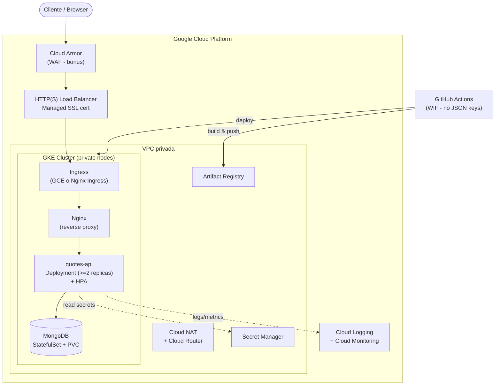

# Arquitectura esperada

Este documento describe la arquitectura de referencia del reto. No tienes que replicarla exacto — si tu diseño es diferente y lo justificas bien, eso también es válido. Pero esta es la línea base.

## Diagrama de referencia

## Componentes

### Red
- **VPC** dedicada, al menos 1 subred en la región elegida.
- **Cloud NAT + Cloud Router** si los nodos son privados (recomendado).
- **Firewall rules** mínimas: solo el tráfico necesario entre LB → nodos.

### GKE
- Puede ser **Autopilot** (más simple, recomendado para este reto) o **Standard** (más control, más configuración).
- Nodos **privados** sin IP pública.
- Workload Identity habilitado.
- Regional (más HA) o zonal (más barato) — justificar.

### Aplicación
- **quotes-api**: Node.js (Express) o la que gustes. Conecta a MongoDB.
- Expone al menos: `GET /health`, `GET /quotes`, `POST /quotes`.
- Imagen en **Artifact Registry**.

### MongoDB
- **StatefulSet** en GKE con PVC (opción default).
- O instancia en Compute Engine (si quieres mostrar ese approach).
- O MongoDB Atlas (si lo justificas: costos, operación, etc.).
- Credenciales en **Secret Manager**, nunca hardcodeadas.

### Nginx
- Entre el Ingress y la API: `Deployment` con `nginx.conf` montada por `ConfigMap`.
- O como **Nginx Ingress Controller** reemplazando al Ingress GCE.
- Debe hacer reverse proxy con headers correctos.

### CI/CD
- **GitHub Actions** con **Workload Identity Federation**.
- Build → Push a Artifact Registry → Deploy a GKE.

### Observabilidad
- **Cloud Logging** nativo.
- **Cloud Monitoring** con métricas y al menos 1 alerta.
- Bonus: Datadog, Prometheus + Grafana.

## Decisiones típicas y trade-offs

| Decisión | Trade-off |
|---|---|
| **Autopilot vs Standard** | Autopilot: simple, menos control de nodos. Standard: flexible, más mantenimiento. |
| **Mongo en GKE vs fuera** | En GKE: integrado, barato. Fuera: no mezclas estado con compute, más operable. |
| **Regional vs Zonal** | Regional: HA real. Zonal: ~3x más barato. Para este reto, zonal es aceptable si lo justificas. |
| **Nginx Ingress vs GCE Ingress** | GCE Ingress: integrado con GCLB. Nginx Ingress: más features, más complejidad. |
| **Helm vs YAML plano** | Helm: reutilizable. YAML: más simple para una app pequeña. |

## Qué NO esperamos para este reto

- Multi-región.
- Replica set de Mongo con 3+ nodos y sharding.
- Service mesh (Istio, Linkerd).
- Zero downtime migrations.
- SLOs formales con error budgets.

Son todas cosas excelentes que puedes mencionar en "qué haría en fase 2".
